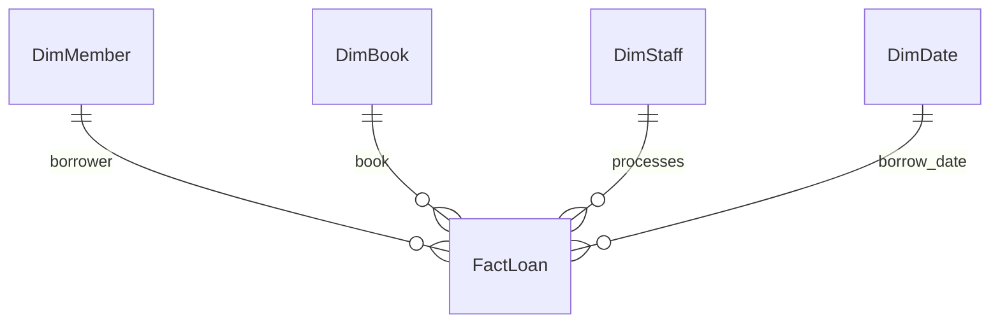

# Library Data Warehouse & Operations Analysis

*Singapore Polytechnic · Data Engineering · Team project*

## Overview

Our team built a MySQL data warehouse for a library case study. It loaded 12,343 completed loan transactions from an operational database and supported reporting on borrowing activity, late returns and staff workload.

## Business Question

How can historical library loan data help explain borrowing patterns, return behaviour and loan-processing workload?

## Project Workflow

1. Implemented a star schema with one fact table and four dimension tables.
2. Loaded completed loans from the operational database and derived loan duration and a late-return indicator.
3. Validated the load by reconciling source and warehouse counts, comparing late-return totals and checking for negative loan durations.
4. Wrote analytical queries to compare borrowing frequency, membership patterns and staff workload.

## Warehouse Schema

Each row in `FactLoan` represents one completed loan transaction.

## Example Analyses

- Compared loan-processing volume and average loans per staff member by department and employment type.
- Ranked the ten most borrowed books and showed their genres and minimum membership tiers.
- Compared weekday and weekend borrowing by genre using loans per calendar day.

## My Contribution

I worked on the MySQL warehouse implementation and contributed to the analytical SQL. The warehouse and queries were developed as part of a team submission.

## SQL Files

| File | Purpose |
| --- | --- |
| [DW_create.sql](DW_create.sql) | Creates the warehouse fact and dimension tables. |
| [DW_insert.sql](DW_insert.sql) | Loads the warehouse from the operational database and runs validation checks. |
| [DW_query.sql](DW_query.sql) | Runs the team's analytical queries. |

The scripts illustrate the warehouse workflow. To reproduce the results, first populate the course-provided operational schema with the source data. Then run the warehouse creation, loading and analysis scripts in that order in a disposable MySQL environment. The creation script drops and recreates the assignment warehouse database. Use consistent database-name casing if your MySQL server treats names as case-sensitive.

## Tools

MySQL, SQL, MySQL Workbench
